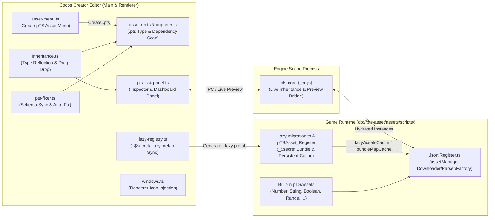

# pTS-Asset

A **ScriptableObject-style custom asset system** (`.pts`) for **Cocos Creator 3.8.8+**, providing a custom asset importer, hierarchical editor creation menus, type-safe drag-and-drop with inheritance validation, a dedicated Inspector with live runtime preview, automatic schema fixing, tree-shaking protection via lazy bundle migration, and runtime hydration through `Json.Register`.

---

## Features

- **Custom `.pts` Asset Pipeline**: Strongly typed ScriptableObject data assets stored as JSON (`__type__` + `__value__`), registered with Cocos Creator's AssetDB (`asset-db.ts`, `importer.ts`) with automatic dependency extraction so referenced assets are never pruned during builds.
- **Hierarchical `Create pTS Asset` Menu (`asset-menu.ts`)**: Right-click in the Assets panel (**Create → Create pTS Asset**) to instantiate any concrete `pTSAsset` subclass. Organize classes into nested submenus using `@pTSAsset.menu("Category/Subcategory/Name")`; `abstract` classes are automatically excluded.
- **Type-Safe Drag & Drop & Asset Picker (`inheritance.ts`)**: Inheritance-aware validation lets you drag `.pts` assets into `@property({ type: TargetClass })` slots (or pick them via the **"More"** dialog) only when the asset's class matches or extends `TargetClass`.
- **Custom `.pts` Inspector (`pts.ts`)**: Full property inspector for `.pts` assets supporting primitives, `Vec2`/`Vec3`/`Vec4`/`Color`/`Rect`/`Size`, `RealCurve`, `Gradient`, `Enum`, nested objects, arrays, and asset references — with **Auto-Save**, **Fix**, **Lazy / Force-Lazy** flags, **Show Code**, and **Selected-Instance Live Preview**.
- **Selected-Instance Live Preview**: Inspect and edit live hydrated `.pts` instances in memory during in-editor playback via subscription-based IPC (`observe-preview-data` / `unobserve-preview-data`), with **Logger** console inspection, `Enum` dropdowns, and clickable runtime `Node`/`Component` locators (`@editor_property`).
- **Schema Fixing & Auto-Migration (`pts-fixer.ts`)**: Automatically detects script changes and repairs/migrates `.pts` files to match updated `@property` definitions, or batch-fixes the entire project via **Extension → pTS-Asset → Update .pts Assets** (or the **pTS-Asset** dashboard panel).
- **Build Tree-Shaking Protection & Lazy Migration (`lazy-registry.ts`, `_lazy-migration.ts`)**: Scans live scenes, prefabs, and bundles to pack unprotected or `isForceLazy` `.pts` dependencies into `db://pts-asset/_$secret/_lazy.prefab` (mounted as a high-priority `_$secret` Asset Bundle). Dead `.pts` assets are automatically excluded.
- **Runtime Serialization & Hydration (`Json.Register.ts`)**: Registers `.pts` downloader, parser, and factory hooks on `cc.assetManager`, handles deferred hydration, resolves cross-bundle UUID asset references, and hydrates `RealCurve`, `Gradient`, and value types seamlessly.
- **Multi-Tier Icon Injection (`windows.ts`)**: Displays the custom `.pts` badge icon across the Assets tree, Asset Picker dialog, and Inspector header.

---

## Requirements

- **Cocos Creator**: `>= 3.8.8`
- **Hard Peer Dependency**: `pts-core` (must be installed in `<your-project>/extensions/pts-core`; provides the `pTSAsset` base class, `@pTSAsset.menu`, `@editor_property`, and scene reflection utilities)

---

## Installation & Setup

1. Ensure `pts-core` is installed in your project's `extensions/` directory:
   ```text
   <your-project>/extensions/pts-core
   ```
2. Copy `pts-asset` into your project's `extensions/` directory:
   ```text
   <your-project>/extensions/pts-asset
   ```
3. Build the extension (if `dist/` is not already compiled):
   ```bash
   cd extensions/pts-asset
   npm install
   npm run build
   ```
4. Enable **pts-asset** in Cocos Creator via **Extension → Extension Manager**.
5. Open the dashboard panel via **Extension → pTS-Asset → Open Panel** (or configure Auto-Save in **Project → Project Settings → pTS Asset**).

---

## Architecture Overview



---

## `.pts` Asset Format

`.pts` files are UTF-8 JSON documents storing the `@ccclass` identifier (`__type__`) and serialized property payload (`__value__`):

```json
{
    "__type__": "WeaponConfig",
    "__value__": {
        "weaponName": "Excalibur",
        "damageMultiplier": 2.5,
        "durability": 100,
        "skillPrefab": {
            "__uuid__": "78b4d9a2-9f3b-4171-a477-90c239420045"
        }
    }
}
```

The accompanying `.pts.meta` stores the resolved `__type__` and extracted `__depends__` UUID list in `userData` for fast AssetDB queries and build dependency tracking.

---

## Usage

### 1. Define a `pTSAsset` Subclass

Extend `pTSAsset` from `db://pts-core/scripts/pTSAsset`, decorate with `@ccclass`, and optionally group it in the **Create pTS Asset** menu using `@pTSAsset.menu(...)`:

```ts
import { _decorator, Prefab, Node } from "cc";
import { pTSAsset } from "db://pts-core/scripts/pTSAsset";
import { editor_property } from "db://pts-core/scripts/utils/pClass";

const { ccclass, property } = _decorator;

@ccclass("WeaponConfig")
@pTSAsset.menu("Configs/Combat/WeaponConfig")
export class WeaponConfig extends pTSAsset {
    @property({ tooltip: "Weapon display name" })
    public weapon_name: string = "Excalibur";

    @property({ tooltip: "Damage multiplier" })
    public damage_multiplier: number = 2.5;

    @property({ tooltip: "Durability points" })
    public durability: number = 100;

    @property({ type: Prefab })
    public skill_prefab: Prefab | null = null;

    // Runtime-only debugging reference (not serialized into .pts, clickable in Live Preview)
    @editor_property(Node)
    public owner_node: Node | null = null;
}
```

> **Tip:** Mark base classes as `abstract class BaseConfig extends pTSAsset` — they remain valid drag-and-drop / picker base types via `inheritance.ts`, while being hidden from the **Create pTS Asset** menu.

### 2. Create & Edit `.pts` Assets in the Editor

1. In the **Assets** panel, right-click a folder and choose **Create → Create pTS Asset → Configs → Combat → WeaponConfig** (or click the **+** button).
2. Select the generated `.pts` file to inspect and edit its `@property` fields directly in the **Inspector**.
3. Use the Inspector controls:
   - **Save / Auto-Save**: Saves changes immediately when Auto-Save is enabled (configurable in **Project Settings → pTS Asset** or the **pTS-Asset** dashboard panel).
   - **Fix**: Re-syncs the `.pts` file against the latest TypeScript class schema.
   - **Lazy / Force-Lazy**: Controls whether the asset is explicitly registered in `_$secret/_lazy.prefab` for build retention.
   - **Show Code**: Displays the backing TypeScript source right inside the Inspector.

### 3. Reference in a Component & Load at Runtime

#### Direct Component Property Reference

```ts
import { _decorator, Component } from "cc";
import { WeaponConfig } from "./configs/WeaponConfig";

const { ccclass, property } = _decorator;

@ccclass("CombatController")
export class CombatController extends Component {
    @property({ type: WeaponConfig })
    public equipped_weapon: WeaponConfig | null = null;

    start() {
        if (this.equipped_weapon) {
            console.log(`Equipped: ${this.equipped_weapon.weapon_name} (x${this.equipped_weapon.damage_multiplier})`);
        }
    }
}
```

Drag your `.pts` asset directly into the `equipped_weapon` slot in the Inspector, or select it via the **"More"** asset picker dialog.

#### Dynamic Runtime Loading

Because `Json.Register.ts` registers the `.pts` downloader, parser, and factory with `cc.assetManager`, `.pts` assets also work with standard Cocos loading APIs:

```ts
import { resources } from "cc";
import { WeaponConfig } from "./configs/WeaponConfig";

resources.load("configs/weapons/excalibur", WeaponConfig, (err, weapon) => {
    if (err || !weapon) return;
    console.log("Loaded weapon:", weapon.weapon_name);
});
```

---

## Selected-Instance Live Preview

During in-editor playback, selecting a `.pts` asset subscribes its Inspector to that UUID without eagerly loading, constructing, or hydrating the asset:

- **Waiting State**: If gameplay has not hydrated the asset yet, the Inspector displays **Waiting for runtime instance...** and automatically links once gameplay loads it.
- **Linked State**: Samples only the selected instance every `200 ms` and skips IPC/re-renders when state is unchanged. Switching selection, closing the Inspector, or stopping preview releases the subscription and restores authoring controls.
- **In-Memory Live Edits**: Writable properties apply to game memory via a single broker path (`set-runtime-property` / `runtime-property-result`). Authoring writes (`Save`, `Fix`, `Lazy` toggles) are disabled during preview.
- **Runtime Locators & Enums**: Fields decorated with `@editor_property(Node)` or `@editor_property(Component)` display clickable locators that highlight the owner node in the runtime Hierarchy. Enum fields render as `name → value` dropdowns via `Enum.getList()`.
- **Logger Button**: While linked, a full-width **Logger** button above **Show Code** runs `console.log('[pTS Logger] <Class> (<uuid>):', instance)` in the Game View to inspect the live object.

---

## Built-in `pTSAsset` Types & Components

`extensions/pts-asset/assets/scripts/` ships ready-to-use `pTSAsset` subclasses and helper components:

| Asset / Component | Path | Description |
| :--- | :--- | :--- |
| `pTSAsset_Boolean`, `pTSAsset_Integer`, `pTSAsset_Number`, `pTSAsset_Range`, `pTSAsset_String`, `pTSAsset_Strings` | `scripts/pTSAssets/` | Reactive primitive & range data assets (`@pTSAsset.menu("Primitive/...")`). |
| `pTSAsset_JsonString`, `pTSAsset_EasingSelector`, `pTSAsset_GraphVariable`, `pTSAsset_Skeleton` | `scripts/pTSAssets/` | Structured JSON, easing, graph variable, and Spine skeleton data assets. |
| `pTSAsset_Register` | `scripts/pTSAssets/pTSAsset.Register.ts` | Component attached to `_lazy.prefab` that registers retained assets into `lazyAssetsCache` on load. |
| `Json.Register` | `scripts/json/Json.Register.ts` | Registers `.pts` `assetManager` pipeline hooks, deferred hydration, and cross-bundle UUID resolution. |
| `Json_Watcher` | `scripts/json/Json.Watcher.ts` | Debug component for inspecting `JsonAsset` events/params and invoking them from the Inspector. |
| `Json.Binder`, `Json.Set.Nodes`, `Data.UI.Displayer` | `scripts/Components/` | Runtime binding and UI display helper components. |

---

## Editor Contributions

### Menu Items

| Menu Path | Label | Triggered Message |
| :--- | :--- | :--- |
| `Extension/pTS-Asset` | **Open Panel** | `open-panel` |
| `Extension/pTS-Asset` | **Reload** | `reload` |
| `Extension/pTS-Asset` | **Update .pts Assets** | `pts::importer::lookup` |
| `Extension/pTS-Asset` | **Re-Scan & Sync Lazy Prefab** | `sync-lazy-prefab` |

### Key IPC Messages

| Message | Purpose |
| :--- | :--- |
| `open-panel` | Opens or focuses the dockable **pTS-Asset** dashboard panel. |
| `reload` | Clears type/class caches, reinstalls AssetDB & IPC hooks, and re-syncs `_lazy.prefab`. |
| `create-pts-asset` | Programmatically creates and initializes a new `.pts` asset for a given class and target folder. |
| `pts::importer::lookup` / `fix-all-pts-assets` | Batch-migrates and repairs all `.pts` files in the project against current scripts. |
| `fix-pts-for-script` | Repairs `.pts` assets associated with a specific TypeScript script file. |
| `sync-lazy-prefab` | Re-scans live scenes/prefabs/bundles and updates `_$secret/_lazy.prefab`. |
| `observe-preview-data` / `unobserve-preview-data` | Subscribes/unsubscribes the Inspector to a live runtime `.pts` instance by UUID. |
| `sync-preview-data` | Delivers changed runtime state snapshots for the active preview session. |
| `set-runtime-property` / `runtime-property-result` | Applies and acknowledges live in-memory property edits during preview. |
| `locate-runtime-reference` | Locates a runtime `Node`/`Component` reference in the Hierarchy. |
| `log-runtime-instance` | Logs the linked runtime `.pts` instance to the Game View console. |

---

## Directory Structure

```text
extensions/pts-asset/
├── assets/
│   ├── icons/pts.png               # Custom .pts asset icon
│   ├── pTS/pTSAction/              # Built-in pTSAction .pts assets
│   └── scripts/
│       ├── _$secret/
│       │   └── _lazy-migration.ts  # Runtime _$secret bundle loader & lazyAssetsCache
│       ├── Components/             # Data.UI.Displayer, Json.Binder, Json.Set.Nodes
│       ├── json/
│       │   ├── Json.Register.ts    # assetManager .pts pipeline & runtime hydration
│       │   └── Json.Watcher.ts     # JsonAsset event/param inspector watcher
│       └── pTSAssets/              # Built-in pTSAsset subclasses & pTSAsset_Register
├── i18n/                           # Localization strings (en, zh)
├── importer/
│   └── core.js                     # Low-level AssetDB importer bridge
├── scripts/                        # Preinstall & regression test scripts
│   ├── test-preview-subscriptions.js
│   ├── test-query-isolation.js
│   └── test-script-code-display.js
├── source/
│   ├── asset-db.ts                 # AssetDB type resolution & dependency hooks
│   ├── asset-menu.ts               # Hierarchical "Create pTS Asset" context menu & scanner
│   ├── cache-bust.ts               # Hot-reload module cache invalidation
│   ├── importer.ts                 # Custom .pts importer & UUID dependency extractor
│   ├── inheritance.ts              # Static/runtime class hierarchy & drag-drop validation
│   ├── lazy-registry.ts            # _$secret/_lazy.prefab scanner & orphan .meta cleanup
│   ├── main.ts                     # Extension lifecycle, IPC broker, auto-fix & hooks
│   ├── panel.ts                    # Dockable pTS-Asset dashboard panel
│   ├── pts-fixer.ts                # Schema normalization & .pts batch/single fixer
│   ├── pts.ts                      # Custom .pts Inspector & Live Preview UI
│   ├── smart_ja.ts                 # Smart_JsonAsset node inspector section
│   └── windows.ts                  # Electron renderer preload for .pts icon injection
├── static/pts.png                  # Packaged editor icon resource
├── bootstrap.js                    # Extension entry point
└── package.json                    # Cocos Creator v2 extension manifest
```

---

## Development & Testing

```bash
cd extensions/pts-asset

# One-time TypeScript build
npm run build

# Watch mode during development
npm run watch

# Run regression tests
npm run test:preview-subscriptions
npm run test:query-isolation
npm run test:script-code-display
```
